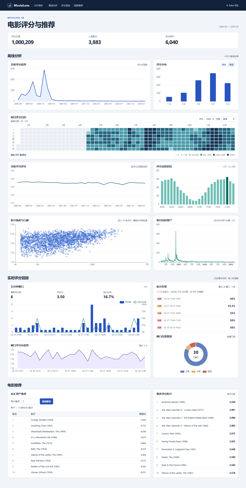
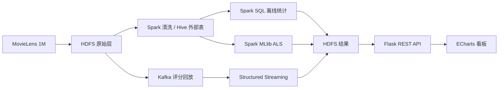

# MovieLens 电影评分分析与推荐

使用 Hadoop、Hive、Spark 和 Kafka 处理 MovieLens 1M，以 Flask API 和 ECharts 看板展示离线统计、历史评分回放、低分告警和个性化推荐。



## 功能

- **数据入湖**。原始评分、电影和用户数据写入 HDFS，经清洗后存为 Parquet，注册六张 Hive 外部表。
- **离线分析**。Spark SQL 统计影片、类型、用户、日期、小时和星级分布。看板包括月度评分趋势、每日活跃用户、影片热度与口碑散点图，以及可按年和季度切换的日历热力图。
- **ALS 推荐**。在 YARN 上训练并保存模型，为已有用户生成未评分影片 Top 10，可加载已有模型进行查询。
- **流式分析**。Kafka 按事件时间回放历史评分，Spark Structured Streaming 生成五分钟窗口，用 checkpoint 从中断处恢复，通过 `foreachBatch` 写入结果。Flask 每 5 秒响应页面轮询，在 Kafka 断开时继续显示最近快照。



## 快速启动

已有项目 HDFS 产物时，使用 Python 3.11 启动看板。先进入克隆得到的仓库目录。

```bash
python -m venv .venv
source .venv/bin/activate
python -m pip install -r dashboard/requirements.txt
export MOVIELENS_WEBHDFS='http://namenode:9870/webhdfs/v1'
export MOVIELENS_DATANODES='{"datanode1":"datanode1","datanode2":"datanode2"}'
export MOVIELENS_KAFKA_BOOTSTRAP='namenode:9092'
python dashboard/app.py --port 5066
```

Windows PowerShell 使用 `& .\.venv\Scripts\Activate.ps1` 激活环境，使用 `$env:变量名 = '值'` 设置环境变量。将配置里的主机名替换为运行 Flask 的电脑可访问的地址。`.env.example` 列出变量名和示例值，可将对应变量导入终端。

打开 [本机看板](http://127.0.0.1:5066/) 即可查看。第一次使用 VMware 的同学先阅读 [三台虚拟机复现指南](docs/vmware.md) 搭好环境，然后按 [部署与复现](docs/deployment.md) 生成数据和结果。

## 目录

| 路径 | 用途 |
| --- | --- |
| [dashboard/](dashboard/) | Flask 应用、前端模板和 ECharts |
| [pipeline/ingest/](pipeline/ingest/) | HDFS 入湖及 Spark 清洗 |
| [pipeline/sql/](pipeline/sql/) | Hive 六表 DDL |
| [pipeline/offline/](pipeline/offline/) | Spark SQL 离线统计 |
| [pipeline/als/](pipeline/als/) | Scala ALS 作业及 PySpark 版本 |
| [pipeline/streaming/](pipeline/streaming/) | Kafka 回放和 Structured Streaming |
| [infra/hadoop/](infra/hadoop/) | 三节点 Hadoop 配置模板 |
| [verification/](verification/) | Hive、Kafka、页面回归核验 |
| [docs/](docs/) | 复现说明、验收结果和页面截图 |

## 接口

| GET 路径 | 返回数据 |
| --- | --- |
| `/api/overview` | 评分、影片、用户数 |
| `/api/offline/trend` | 月度趋势、平均分、每日评分量和活跃用户、评分分布与类型 |
| `/api/offline/hourly` | UTC 逐小时评分量 |
| `/api/offline/movie-scores` | 有至少 50 条评分的影片评分量和平均分 |
| `/api/movie/ranking` | 热门影片排行 |
| `/api/recommendations?user_id=1` | 指定用户的 ALS 推荐 |
| `/api/realtime` | 五分钟窗口、数据来源和连接状态 |
| `/api/alerts` | 最近快照的中、高度低分告警 |

## 验收结果

| 项目 | 项目原集群统计 |
| --- | --- |
| 数据量 | 1,000,209 条评分、3,883 部影片、6,040 位用户 |
| ALS | 60,400 条推荐。RMSE 0.8923，MAE 0.7097，测试评分覆盖率 52.19% |
| 流式分析 | 55,841 个有评分的五分钟窗口，原回放峰值约 15,409 条/秒 |
| 看板 | 8 个 API、10 个图表区。测试断开 Kafka 后仍显示最近 30 个有评分窗口 |

完整口径见 [验收记录](docs/verification.md)。

## 数据和来源

从 [GroupLens MovieLens 1M](https://grouplens.org/datasets/movielens/1m/) 获取原始数据，遵守 [数据使用许可](https://files.grouplens.org/datasets/movielens/ml-1m-README.txt)。仓库提供代码、示意截图和汇总指标，数据、模型和流式产物由流水线生成。

此课程项目的技术路线参考 [Distributed Spark Movie Recommender](https://github.com/zubiiabbasi/distributed-spark-movielens-recommender)。随项目分发的 Apache ECharts 保留原 [LICENSE](dashboard/static/echarts-LICENSE.txt) 和 [NOTICE](dashboard/static/echarts-NOTICE.txt)。
